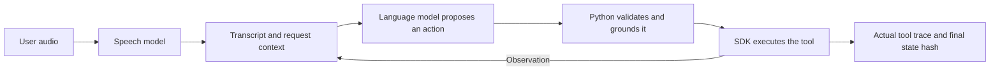

# AI for software engineers, using LifeMate

Work through one feature you already know how to build in software. A user says “Nhắn cho Lan là tôi đến muộn 15 phút.” The app must find the right Lan, send the message when it has enough information, and retain an auditable record. LifeMate delegates speech recognition and the choice of next action to models. Python controls the available tools, validates arguments, executes the action and handles failure.

You can do the code-reading exercises with the core Python environment from the [local quickstart](local_quickstart.md). Save the model exercises for after the SDK smoke succeeds.



## 1. Understand what a model does at runtime

A **model checkpoint** stores learned numerical parameters called weights. Its configuration describes how to load them. **Inference** uses those weights on new inputs. In a causal language model, the tokenizer encodes text into token IDs. The model scores possible next tokens from the context, and a decoding rule selects one. This repeats until the model stops or reaches a limit. A token can represent a word, part of a word, or punctuation. Greedy decoding chooses the highest-scoring token at each step. [Transformers text generation](https://huggingface.co/docs/transformers/v4.56.2/en/llm_tutorial)

| AI concept | Familiar software idea | In LifeMate |
| --- | --- | --- |
| Prompt and chat template | A request plus a serialization format | Messages carry instructions, user context, tool schemas and previous observations. The model's chat template formats message roles for its tokenizer |
| Context window | A request-size budget | History, catalog schemas, observations and generated output all consume tokens. Long requests can exceed the budget before a tool runs |
| Model server | A local HTTP dependency | The Ollama backend calls the local chat API. The Transformers backend loads the language model directly in the Python process |
| Model version | A versioned runtime dependency | Record the checkpoint revision, tokenizer, decoding settings and any adapter when comparing runs |

**Read the code.** Open [the Transformers adapter](../src/lifemate/adapters/transformers.py). Find `apply_chat_template`, the prompt-plus-output budget check, and the call to `generate`. Then look at [the Ollama adapter](../src/lifemate/adapters/ollama.py) to see the same policy responsibility behind a different interface. [Chat templates](https://huggingface.co/docs/transformers/v4.56.2/en/chat_templating) · [Ollama chat API](https://docs.ollama.com/api/chat)

**Check your understanding.** What happens if the model and tokenizer stay fixed but a tool observation is added to the prompt? The model now conditions its next prediction on different input. Its learned weights are the same.

## 2. Understand tool calling and agents

A **tool** is an application operation described by a name and argument schema. A **policy** is the part that chooses the next action. An **agent loop** puts a policy inside a workflow that can observe the result and decide again. In LifeMate, the model proposes one action envelope at a time. Python treats that envelope like untrusted input at an API boundary.

For the Lan example, assume both apps are installed. The following model proposal uses an argument supported by the train catalog. The values and scenario are illustrative.

```json
{"kind":"CALL","tool_name":"contacts.search","arguments":{"query":"Lan"}}
```

1. Python checks that the tool is eligible for the sample and the argument fits its schema, then calls it through the SDK.
2. The actual observation goes into the next prompt. With a uniquely identified contact, the model can propose `sms.send` with the observed `contact_id` and message `content`.
3. If two contacts match and the request cannot distinguish them, the model can propose ASK for a missing recipient. The loop maps ASK to `sys.ask_missing_info`. DONE ends the loop as an internal decision.
4. The same SDK session returns the executed calls and state hash. This is the record to inspect when debugging or evaluating a run.

**Read the code.** Follow [the loop](../src/lifemate/runtime/loop.py) into [validation](../src/lifemate/runtime/validation.py) and [reference tracking](../src/lifemate/runtime/references.py). Schema validation can confirm that `contact_id` is a string. Grounding checks whether allowed evidence supports that ID. The actual tool response determines whether the send succeeded.

**Try it.** Run `& $Python -m unittest discover -s tests -p test_loop.py -v` from `LifeMate/` using the PowerShell variable from the quickstart. Find the tests for an ambiguous lookup, an unsupported request, and a write followed by ASK. For each one, identify which model proposals became actual calls. [Agent loop fixtures](../tests/test_loop.py)

## 3. Isolate speech recognition from decision errors

**Automatic speech recognition**, or ASR, converts audio to text. LifeMate's Whisper adapter transcribes earlier user audio and the latest request. If the ASR transcript changes “15 phút” to “50 phút,” the policy can select the right tool and still send the wrong content. This creates two independently testable stages. [LifeMate speech adapter](../src/lifemate/adapters/whisper.py) · [Whisper documentation](https://huggingface.co/docs/transformers/v4.56.2/en/model_doc/whisper)

| What you observe on the same scenario | What to investigate |
| --- | --- |
| Oracle text succeeds and audio fails | Compare transcripts, then trace the critical name, amount, time, or negation into the action arguments |
| Both runs fail before the first correct tool | Inspect eligible schemas, the plan, tool selection, and context construction |
| The model chooses the correct tool and the runtime rejects it | Inspect the argument schema, reference evidence, goal binding and SDK validation |
| The calls look right but the state differs | Inspect execution order and actual tool results, including writes that completed with no effect |

**Try it.** Before using weights, read `test_history_latest_order_and_no_oracle_fallback` and trace how the supplied audio turns become text. When you have the models, compare oracle text and audio on the same frozen validation IDs. Keep the policy, settings and SDK constant so the paired result helps isolate the effect of transcription. [Audio fixtures](../tests/test_audio.py) · [Paired evaluation steps](milestones/04-audio-and-evaluation.md)

## 4. Learn what fine-tuning changes

**Pretraining** learns general patterns from large datasets. **Supervised fine-tuning**, or SFT, adapts an existing model by showing it examples of inputs and desired outputs. LifeMate's training objective is one next-action JSON object. Its train scenarios supply tool calls, and replay supplies real prior observations for later steps. [TRL SFT Trainer](https://huggingface.co/docs/trl/v0.23.1/en/sft_trainer)

Think of a trajectory as a test trace that becomes several labeled examples. Each row has only the context available at that point.

| Step | Context added so far | Target to learn |
| --- | --- | --- |
| 0 | Request, tools and starting context | CALL `contacts.search` |
| 1 | The lookup observation, including the grounded contact ID | CALL `sms.send` |
| 2 | The lookup and send observations | DONE |

The trainer computes loss on the action tokens and end-of-sequence token. The prompt and padding use the ignore label `-100`. With **teacher forcing**, each target token is predicted from the preceding reference tokens. At the tool-step level, each training row uses the reference calls and replayed observations up to that point. During inference the agent continues from the observations its own calls produce. Freeze fit and validation by whole scenario before expansion so related rows stay together. [Trajectory builder](../src/lifemate/learning/trajectories.py) · [Tokenization and masking](../src/lifemate/learning/serialization.py)

**LoRA**, or low-rank adaptation, freezes the base weights and learns a smaller set of parameters for selected layers. Think of the saved adapter as an add-on with an exact dependency on the base checkpoint and tokenizer. LifeMate trains with Transformers, PEFT and TRL. It loads the saved adapter through the Transformers policy backend. A lower training loss is one measurement, while the release decision depends on held-out action quality and latency. [Training implementation](../src/lifemate/learning/trainer.py) · [Original LoRA paper](https://arxiv.org/abs/2106.09685)

**Try it.** Open `test_single_action_masks_call_ask_done_previous_action_not_supervised` and mark which tokens contribute to loss. Then use the [training dry-run](local_quickstart.md#4-prepare-and-train-lora) to check a real configuration once you have local inputs. The dry-run checks data and fingerprints before the training runtime loads weights. [Training fixtures](../tests/test_training.py)

## 5. Evaluate an AI feature like a system

| Question | Evidence to collect |
| --- | --- |
| Did Python enforce the contract? | Unit and integration tests with scripted policies for malformed arguments, denied tools, duplicate writes and timeouts |
| Did the model make good decisions? | A fixed holdout, actual call traces and final SDK state hashes. Look at extra and missing calls, clarifications and incomplete goals |
| Did a change help? | A paired run on the same scenarios with one deliberate change. Record code, model, input and configuration identities |
| Can it ship? | Model startup, end-to-end latency, timeout count, peak memory and repeatable output on the offline target runtime |

LifeMate's local evaluator combines state matching and tool-call matching as a **proxy** for Zalo scoring. ASR word and character error rates help diagnose transcription, and critical-field checks show when a small transcript change can change the action. Use actual traces to connect the measurements. [Metrics code](../src/lifemate/metrics/) · [Evaluation milestone](milestones/04-audio-and-evaluation.md) · [Zalo Evaluation tab](https://challenge.zalo.ai/portal/lifemate)

## 6. Recognize related AI techniques

| Technique | Problem it addresses | How to reason about it as an engineer |
| --- | --- | --- |
| Prompt engineering | How to present instructions, schemas and evidence | Version the prompt and test its effect on a fixed validation set. It changes the model's input at inference time |
| Retrieval-augmented generation (RAG) | How to give a model relevant external knowledge at request time | Think search plus request assembly. An embedding is a numeric vector that can support similarity search. Retrieved records become prompt context. LifeMate gets live app evidence from SDK tools such as contact search. [Original RAG paper](https://arxiv.org/abs/2005.11401) |
| Quantization | How to reduce the memory footprint of model weights | Lower-precision representations can reduce weight storage. Measure quality and runtime on the intended hardware. The Qwen Ollama example uses a quantized artifact, and LifeMate's LoRA trainer expects a complete local Transformers-format base. [Transformers text generation](https://huggingface.co/docs/transformers/v4.56.2/en/llm_tutorial) · [Ollama model formats](https://docs.ollama.com/import) |

For a first project exercise, run the SDK smoke, explain why its trace and hash are trustworthy, then run the oracle-text pilot and inspect a case the model gets wrong. Choose the next change based on where that trace first diverges from the expected behavior. [Local quickstart](local_quickstart.md) · [Optimization milestone](milestones/05-optimization-and-training.md)
