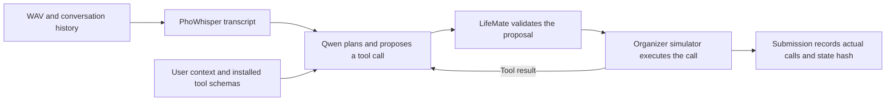

# LifeMate 2026

LifeMate turns a spoken Vietnamese request into actions in the Zalo AI Challenge simulator. Given a WAV file, conversation history, user context, and the tools installed for that sample, it can look up an entity, execute one or more actions, or ask for missing information. An unsupported request produces an empty call list. Zalo evaluates the tool calls and the resulting simulator state. [LifeMate challenge](https://challenge.zalo.ai/portal/lifemate)

## How it works

For example, “Nhắn Minh là tôi đến muộn” can require a contact search followed by an SMS. PhoWhisper transcribes the request, Qwen chooses a tool, and LifeMate checks that the contact ID came from evidence such as the search result. The simulator executes the validated SMS and provides the final state hash. If several contacts match and the context cannot resolve which one is Minh, the agent can ask for clarification.

## Start here

| Goal | What to open |
| --- | --- |
| Understand the whole application and the AI concepts behind it | [learn.md](learn.md) traces one request through the code, explains evaluation, and shows when LoRA is worth trying |
| Run tests and one real simulator call | [Application README](LifeMate/README.md) and [local quickstart](LifeMate/docs/local_quickstart.md) |
| Run an audio pilot and generate `submission.jsonl` | [Competition run guide](LifeMate/docs/competition_run.md) |
| Fine-tune and compare an adapter | [LoRA walkthrough](learn.md#5-fine-tune-the-action-policy-with-lora) and [training commands](LifeMate/docs/local_training.md) |
| Prepare the private-test handoff | [Submission checklist](LifeMate/docs/milestones/06-zalo-submission.md) |

## What is implemented

- **Inference.** The competition configuration uses local PhoWhisper-small and Qwen3-4B-Instruct-2507 Q4_K_M. Every sample uses its own organizer simulator session. The public writer produces `id`, `tool_calls`, and `state_hash`. The private-test configuration and timing notebook also write the elapsed milliseconds as `time`. [Model and reproducibility details](LifeMate/training_code/README.md)
- **Evaluation.** The labeled train split supports simulator replay, a frozen holdout, and a local proxy score. A real-audio pilot verified CLI and notebook parity on four public samples. Train replay verified the simulator contract across 1,545 labeled scenarios. The four-sample pilot measured integration and timing. Leaderboard accuracy and organizer-hardware timing still need measurement. [Scoring details](LifeMate/docs/scorer_parity.md)
- **Training.** The repository can build training examples from labeled train traces and train a LoRA adapter for the action policy. The current competition configuration uses the published checkpoints. Training-data generation and trainer preflight were verified locally. [Training workflow](LifeMate/docs/local_training.md)

Run application commands from `LifeMate/`. The organizer kit, downloaded weights, and prediction outputs are local inputs or artifacts. GitHub contains the source, configuration, tests, and documentation.
