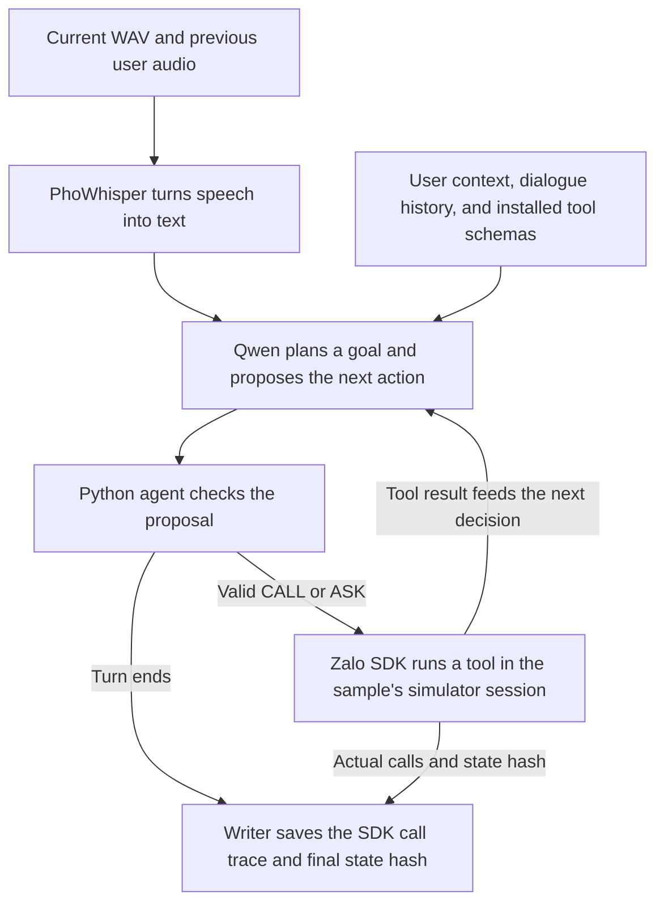
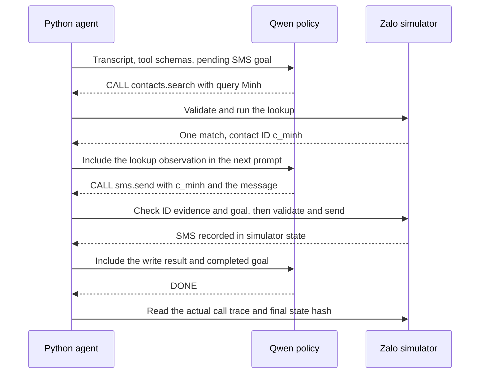
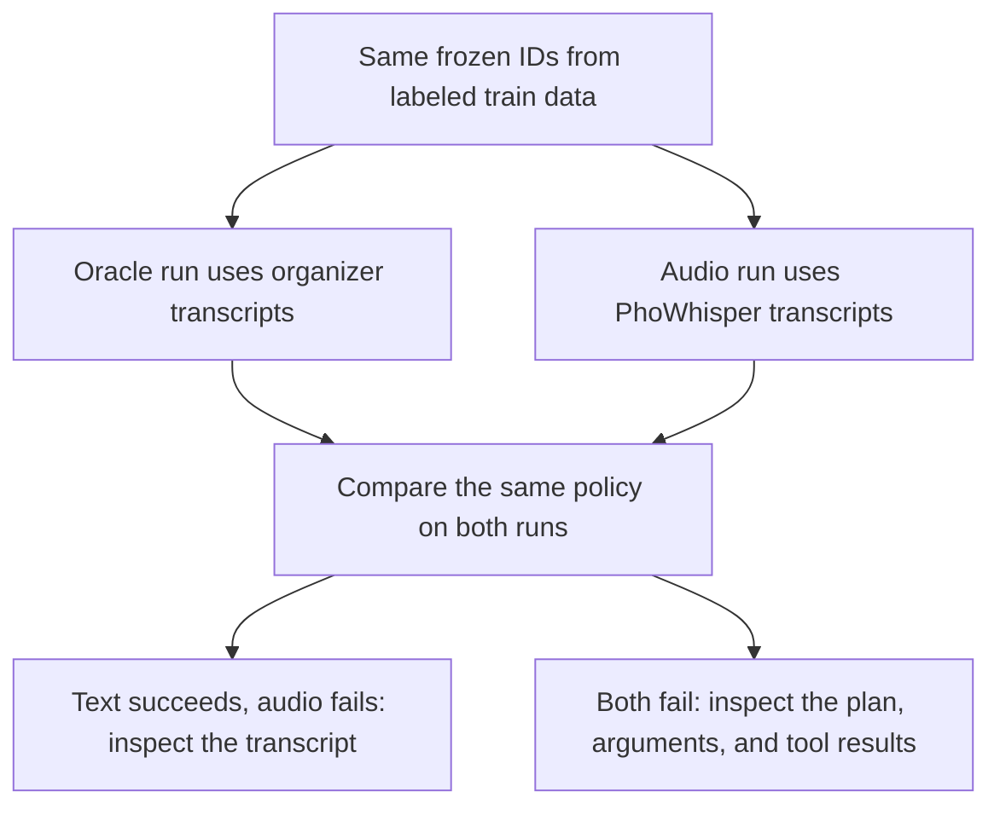
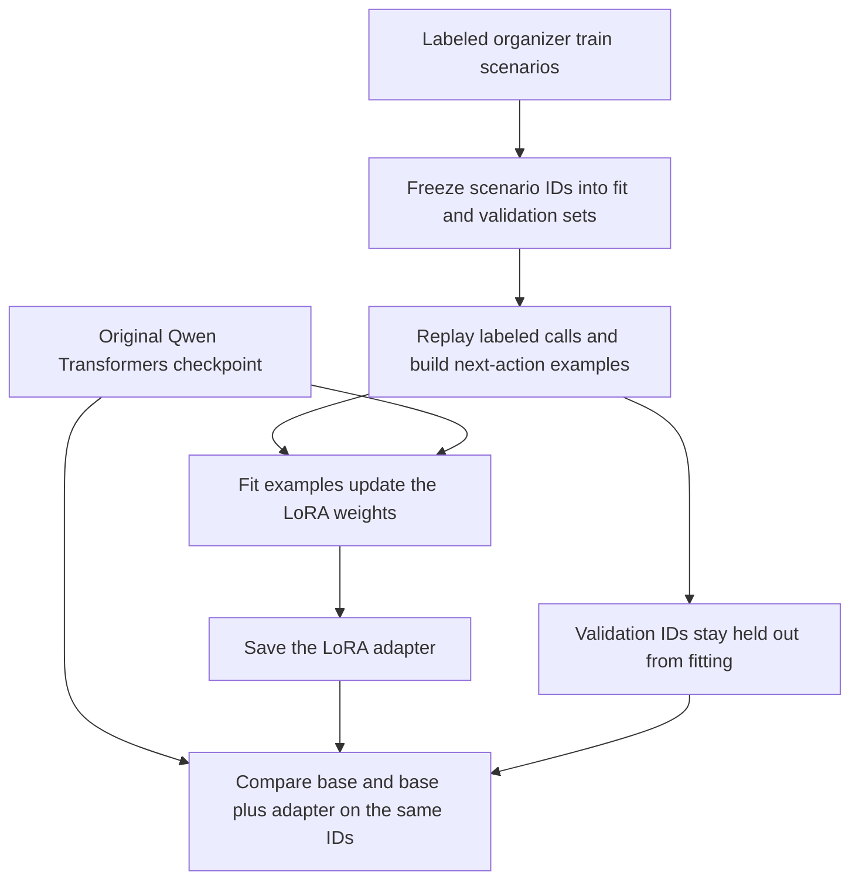

# Learn LifeMate by following one request

**“Nhắn Minh là tôi đến muộn”** means “Text Minh that I’ll be late.” LifeMate has to turn that sentence into an SMS in Zalo’s simulator. It needs to hear the name correctly, find the right contact ID, and send the message once. Zalo receives the executed tool calls and the resulting state hash. [LifeMate challenge](https://challenge.zalo.ai/portal/lifemate)

**Read in order:** [Core flow](#1-see-the-core-flow) → [Worked SMS example](#2-follow-one-request-through-the-code) → [What-if cases](#3-change-the-example-and-predict-the-result) → [Evaluation](#4-use-evaluation-to-find-the-failing-layer) → [LoRA](#5-fine-tune-the-action-policy-with-lora).

## 1. See the core flow



PhoWhisper answers **what did the user say?** Qwen answers **what action should happen next?** The Python agent decides **can this proposal run with the evidence we have?** The SDK is the **source of truth for what happened**. The training workflow is optional. The default competition run loads existing checkpoints from disk. [Model setup and revisions](LifeMate/training_code/README.md)

## 2. Follow one request through the code

The examples below use a fictional sample and contact. The call names and argument names match the public kit. The tests linked throughout this walkthrough use small fixtures so you can see each behavior without running a language model.

### A. Open one sample and transcribe its audio

`predict` loads models once for the run. For each manifest row it gets an ID, the audio path, history, and context such as the sample’s clock and installed apps. `infer` opens one session from that split’s SDK. The session starts with earlier actions already applied. `prepare_audio` transcribes historical user audio and the latest WAV. The transcript is now usable in a prompt.

| Concept | In the example | Code to open |
| --- | --- | --- |
| **Dataset split** | The selected split supplies the manifest, tool catalog, and simulator SDK. The sample’s installed tools determine which catalog entries the agent may use | [`predict`](LifeMate/src/lifemate/workflows.py#L158), [`allowed_tools`](LifeMate/src/lifemate/data/kit.py#L83), [`open_env`](LifeMate/src/lifemate/adapters/sdk.py#L36) |
| **Automatic speech recognition (ASR)** | The WAV becomes `Nhắn Minh là tôi đến muộn`. The audio adapter reads PCM WAV, converts to mono, and resamples when needed | [`prepare_audio`](LifeMate/src/lifemate/adapters/whisper.py#L38), [`WhisperAsr.transcribe`](LifeMate/src/lifemate/adapters/whisper.py#L109) |
| **Normalization** | A request like “ba giờ chiều mai” can yield a date-time candidate using the sample’s clock. The prompt retains the original wording alongside the candidates | [`normalize`](LifeMate/src/lifemate/runtime/normalize.py#L62), [normalization tests](LifeMate/tests/test_normalize.py) |

Learn how Whisper converts multilingual audio to text. [Whisper paper](https://arxiv.org/abs/2212.04356) · [PhoWhisper model card](https://huggingface.co/vinai/PhoWhisper-small)

### B. Turn the transcript into a goal and a next action

The **goal** is to send an SMS with the requested text. A contact lookup is a **step** toward that goal. The planner records the requested action and the span of text it came from. The goal ledger tracks pending and completed occurrences, which lets the runtime distinguish a new requested send from a duplicate of one already completed.

At each step the prompt includes installed tool schemas, dialogue, the latest transcript, and observations from this turn. A **tool schema** describes the function’s name and argument rules. In this example, `contacts.search` accepts `query`. `sms.send` needs `content` and a recipient expressed as either `contact_id` or `phone_number`.

```json
{"kind":"CALL","tool_name":"contacts.search","arguments":{"query":"Minh"}}
```

`CALL` is the model’s proposal. `ASK` names a target tool and missing parameters. `DONE` ends the turn when the agent has finished or there is no supported goal. The competition backend runs Qwen from local GGUF weights using llama.cpp. Quantization uses fewer bits to represent weights for inference. [Prompt builder](LifeMate/src/lifemate/runtime/context.py#L27) · [Decision contracts](LifeMate/src/lifemate/contracts.py) · [Goal planner and ledger](LifeMate/src/lifemate/runtime/goals.py#L25) · [Qwen model card](https://huggingface.co/Qwen/Qwen3-4B-Instruct-2507) · [llama.cpp adapter](LifeMate/src/lifemate/adapters/llama_cpp.py#L169)

### C. Use the lookup result as evidence for the write



This feedback loop is what makes the program an **agent**. It can base its next decision on information obtained after the request began. **Grounding** means `c_minh` came from the lookup result. Before sending, Python checks the call shape, the reference evidence, and the pending goal. The SDK then validates and executes the call. A rejected proposal can be sent back to the model for a bounded correction. [Action loop](LifeMate/src/lifemate/runtime/loop.py#L115) · [Schema checks](LifeMate/src/lifemate/runtime/validation.py#L108) · [Reference index](LifeMate/src/lifemate/runtime/references.py#L111) · [Read-then-write test](LifeMate/tests/test_runtime.py#L218)

### D. Read what was actually submitted

The SDK trace uses `name` and `arguments`. Its `state_hash` is a fingerprint of the final simulated app state. Here `state_hash` is a placeholder for the real SDK value. The example is formatted over several lines for readability. The file stores one JSON object per line.

```json
{
  "id": "demo_sms",
  "tool_calls": [
    {"name": "contacts.search", "arguments": {"query": "Minh"}},
    {"name": "sms.send", "arguments": {"contact_id": "c_minh", "content": "Tôi đến muộn"}}
  ],
  "state_hash": "<SHA-256 returned by the SDK>"
}
```

| File | Use it to answer |
| --- | --- |
| `submission.jsonl` | Which calls ran, in what order, and what state did they leave? The timed private format adds `time` in milliseconds |
| `submission.diagnostics.json` | What did ASR hear? What did Qwen propose? Which check rejected a proposal? Where did the time go? |
| `submission.run.json` | Which samples were selected and completed? Did the batch finish and publish its final file? |

[SDK output in the loop](LifeMate/src/lifemate/runtime/loop.py#L246) · [Artifact writer](LifeMate/src/lifemate/prediction_artifacts.py) · [Timing notebook](LifeMate/predict_notebook.ipynb)

## 3. Change the example and predict the result

| Change | Expected behavior | Where to see it |
| --- | --- | --- |
| The lookup finds two people named Minh and the dialogue gives no way to choose | The lookup is recorded. The agent can call `sys.ask_missing_info` with target `sms.send` and `params: ["contact_id"]`, then end the turn | [Ambiguous lookup test](LifeMate/tests/test_loop.py#L166) |
| The user asks to send an SMS but the request leaves out the message | The agent can ask for `content` if the context supplies no message | [ASK conversion](LifeMate/src/lifemate/runtime/validation.py#L108) |
| The request requires a tool the user does not have and there is no supported goal | The session returns `tool_calls: []` and its actual state hash | [Empty plan test](LifeMate/tests/test_loop.py#L145) |
| The model proposes the same SMS again after the first succeeds | The completed goal occurrence prevents a second send unless the user explicitly requested another occurrence | [Goal binding](LifeMate/src/lifemate/runtime/goals.py#L150) |

Run [one SDK read](LifeMate/docs/local_quickstart.md#1-run-one-sdk-read) first to verify the simulator connection. Then run the [public audio pilot](LifeMate/docs/competition_run.md#public-test-on-windows) with `--limit 8` and follow one ID across the three output files. For the full split, remove the limit and run the [submission checks](LifeMate/docs/milestones/06-zalo-submission.md#1-validate-and-upload-the-public-result).

## 4. Use evaluation to find the failing layer

**A validator checks whether the file is usable.** The project checks IDs, order, and row format. The organizer’s validator checks tool calls against its schemas. A valid call can still send the wrong message.

**An evaluator checks whether the action was correct.** On labeled train scenarios, replay the expected calls to obtain reference hashes. The local proxy compares predictions with the expected calls. For a nonempty expected trace, a wrong final hash scores zero. With a matching hash, extra or mismatched calls can still reduce the score. [Gold replay](LifeMate/src/lifemate/data/replay.py#L6) · [Proxy score](LifeMate/src/lifemate/metrics/proxy.py#L72) · [Scoring assumptions](LifeMate/docs/scorer_parity.md)



If the oracle run finds Minh but the audio run searches for Bình, check ASR before changing the policy. If both runs correctly hear Minh and still send to an ungrounded ID, inspect the proposed arguments and the reference guard. If both send correctly but add an unnecessary second search, inspect the trace and stopping decision. Compare time spent in ASR and model generation when a correct trace takes too long. [Paired evaluation procedure](LifeMate/docs/milestones/04-audio-and-evaluation.md) · [ASR metrics](LifeMate/src/lifemate/metrics/asr.py#L42) · [Report comparison](LifeMate/src/lifemate/metrics/reports.py#L60)

## 5. Fine-tune the action policy with LoRA

Try this experiment when the text baseline repeatedly makes the same tool-selection or argument mistakes on held-out requests. **Supervised fine-tuning (SFT)** learns from labeled examples of the next decision. `lifemate trajectories` uses organizer train traces to turn a multi-step request into several training rows. This is **teacher forcing** because each row uses the correct preceding observations. During inference the policy sees the actual results of its own calls.

| Training row | Information the model sees | Target it learns to emit |
| --- | --- | --- |
| 1 | The SMS request and available tools | `CALL contacts.search` with `query: "Minh"` |
| 2 | The same request plus the lookup result `c_minh` | `CALL sms.send` with `contact_id: "c_minh"` and the text |
| 3 | The request, lookup result, and successful send result | `DONE` |

**LoRA (Low-Rank Adaptation)** freezes the original model weights and learns a small update for selected layers. In LifeMate’s example config, each update is represented by two smaller matrices with rank 16, applied to Qwen’s attention query and value projections (`q_proj` and `v_proj`). Rank controls the size of those updates. The trainer masks the prompt and padding so loss comes from the target action and end-of-sequence token. This trains the text action policy. PhoWhisper supplies transcripts independently. [LoRA paper](https://arxiv.org/abs/2106.09685) · [PEFT guide](https://huggingface.co/docs/peft/conceptual_guides/lora) · [LoRA config](LifeMate/configs/training.lora.json) · [Token and label preparation](LifeMate/src/lifemate/learning/serialization.py#L23)



1. **Prepare.** Run `lifemate freeze`, `lifemate replay`, and `lifemate trajectories` on the train kit. Split by scenario ID before expanding steps so one conversation stays on one side of the split. [Split code](LifeMate/src/lifemate/data/splits.py#L14) · [Trajectory code](LifeMate/src/lifemate/learning/trajectories.py#L19) · [Preparation commands](LifeMate/docs/local_training.md#1-what-training-data-is-available)
2. **Fit.** Use the original Qwen Transformers checkpoint and matching tokenizer. Run the trainer’s `--dry-run` to check the inputs and fingerprints. Run the training command without that flag to produce the adapter. [Trainer preflight](LifeMate/src/lifemate/learning/trainer.py#L15) · [LoRA training code](LifeMate/src/lifemate/learning/trainer.py#L103) · [Training commands](LifeMate/docs/local_training.md#4-start-fine-tuning-when-ready)
3. **Compare.** Use the Transformers backend for both runs. Load the candidate with `--adapter-path` and compare it against the same base on identical held-out IDs. Then repeat with audio and measure latency. The competition launcher currently loads a published GGUF. A better adapter needs its own artifact preparation and verification on the intended runtime before it goes into the competition config. [Adapter inference](LifeMate/docs/local_training.md#6-run-the-saved-adapter) · [Competition config](LifeMate/configs/inference.competition.json)

To check your understanding, find `test_read_then_observation_grounded_write`. Follow the first call from the model proposal to the tool result, then locate the line where the second proposal reads that result for the contact ID. [Worked runtime test](LifeMate/tests/test_runtime.py#L218)
